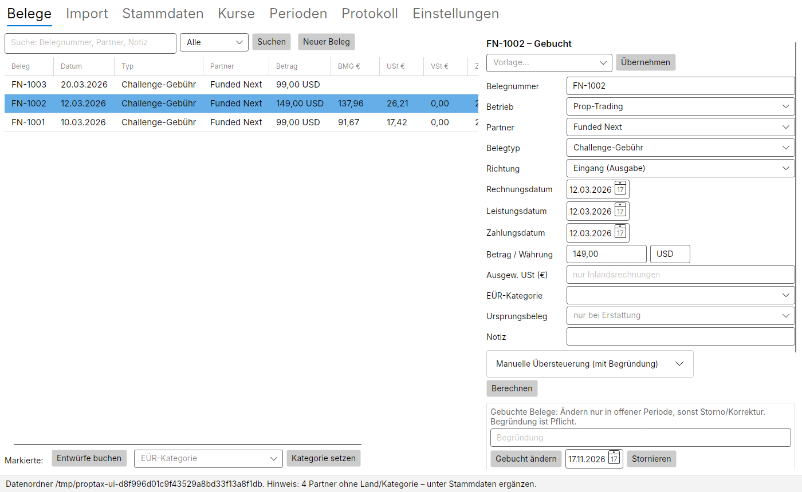

# PropTax

Lokale Buchhaltungs- und Umsatzsteuer-Software (Windows, offline) für Prop-Trading und Onlinehandel eines
Einzelunternehmers: EÜR je Betrieb, gemeinsame USt-Betrachtung mit §13b und §19-Grenzmonitor, GoBD-orientiertes
Änderungsprotokoll, verschlüsselte SQLite-Datenbank, Datensicherung.

> **Keine Steuerberatung.** Alle Regeln, Sätze, Grenzen und Kennzahlen sind konfigurierbare Startwerte und vor
> produktivem Einsatz fachlich zu prüfen – offene Punkte: [`docs/steuerregeln.md`](docs/steuerregeln.md).



## Nutzung
- Download: GitHub › Actions › Artefakt `PropTax-win-x64` bzw. Release (`PropTax.App.exe`, eine Datei, ~60 MB).
- Bedienung: [`docs/handbuch.md`](docs/handbuch.md)

## Entwicklung
Voraussetzung: .NET 10 SDK.
```bash
dotnet build
dotnet test
dotnet run --project src/PropTax.App
dotnet run --project src/PropTax.App -- --selftest
build/publish-windows.sh 1.0.0
```

| Dokument | Inhalt |
|---|---|
| [`docs/adr/0001-technologie-stack.md`](docs/adr/0001-technologie-stack.md) | Technologieentscheidung |
| [`docs/architektur.md`](docs/architektur.md) | Schichten, GoBD, Auswertungen |
| [`docs/datenmodell.md`](docs/datenmodell.md) | Datenmodell (Quelle: `src/PropTax.Persistence/Schema/*.sql`) |
| [`docs/steuerregeln.md`](docs/steuerregeln.md) | Steuerregeln, Abnahmefälle, offene Punkte |
| [`CLAUDE.md`](CLAUDE.md) | Konventionen und Befehle |

Lizenzen der Abhängigkeiten: Avalonia (MIT), CommunityToolkit.Mvvm (MIT), Dapper (Apache-2.0),
Microsoft.Data.Sqlite (MIT), SQLite3 Multiple Ciphers (MIT), ClosedXML (MIT),
QuestPDF (Community-Lizenz – kostenfrei bis 1 Mio. USD Jahresumsatz).
