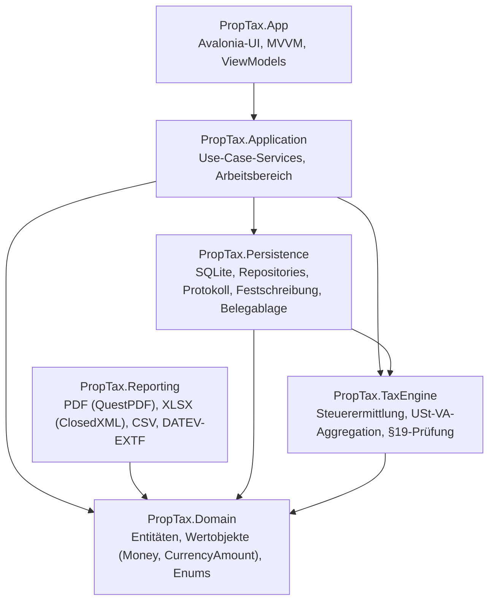

# Architektur

## Schichtenmodell

| Projekt | Darf referenzieren | Darf **nicht** referenzieren |
|---|---|---|
| Domain | – | alles andere |
| TaxEngine | Domain | Persistence, Reporting, App, Avalonia, EF Core, SQLite |
| Persistence | Domain, TaxEngine | Application, App, Reporting, Avalonia |
| Application | Domain, TaxEngine, Persistence | App, Avalonia |
| Reporting | Domain (bekommt fertige Auswertungsmodelle) | App, Persistence |
| App | Application (transitiv Domain/Engine-Typen) | Persistence, Microsoft.Data.Sqlite, Dapper |

Die Regeln werden durch `tests/PropTax.ArchitectureTests` erzwungen. Dort ist auch das Verbot von
`double`/`float` in Domain und Engine geprüft.

## Engine-Prinzipien
- **Rein funktional:** Eingabe Beleg + Regelkontext → Ausgabe `SteuerErgebnis`. Keine I/O.
- **Datengetrieben:** Regeln, Sätze, Kurse, Kennzahlen und Grenzwerte kommen über Schnittstellen
  (`IRegelwerk`; Implementierungen `InMemoryRegelwerk`, DB über `RegelwerkRepository.Laden`). Es gibt keine fachlichen Konstanten im Code.
- **Erklärbar:** Jedes Ergebnis enthält Regel-ID, Kurs, Satz, Kennzahl und eine Begründungskette
  für den Drill-down.
- **Übersteuerbar:** Manuelle Übersteuerung ist ein eigenes Eingabeobjekt mit Pflicht-Begründung.

## Datenfluss Beleg
1. Erfassung/Import → `beleg` (Status `entwurf`)
2. Engine berechnet → `beleg_steuer` (Snapshot), optional manuelle Übersteuerung
3. Buchen → Status `gebucht`, Periodenzuordnung (USt-Periode und EÜR-Periode getrennt)
4. Festschreibung der Periode → Belege unveränderlich; Änderungen nur per Storno-/Korrekturbeleg
5. Jede Änderung → `protokoll` (Hash-Kette)

## GoBD-Umsetzung (zweistufig)
1. **Anwendung:** `Belegaenderung` (Domain) + Services prüfen Periodenstatus und Begründungspflicht und protokollieren.
2. **Datenbank:** Trigger sperren UPDATE/DELETE an Protokoll, festgeschriebenen Perioden, Belegen und Steuer-Snapshots
   in festgeschriebenen Zeiträumen sowie das Verschieben hinein. Die Hash-Kette deckt Manipulationen auch
   bei entfernten Triggern auf (`Protokoll`-Reiter zeigt den Kettenstatus).

## ERiC-Vorbereitung
Die USt-VA wird als abstraktes Modell `UstVaDatensatz` (Zeitraum, Kennzahl → Betrag) erzeugt.
Eine spätere Klasse `EricUebermittlung` in einem eigenen Projekt (`PropTax.Elster`) bindet die
ERiC-C-Bibliothek per P/Invoke an. Engine und UI bleiben dabei unverändert.

## Build & Auslieferung
- Entwicklung und Tests: Linux oder Windows (`dotnet test`)
- Windows-Executable: `dotnet publish -r win-x64 --self-contained -p:PublishSingleFile=true` (ca. 48 MB inkl. SQLite)
- CI: `.github/workflows/build.yml` mit Tests auf Ubuntu, Publish und Smoke-Test (`--selftest`) auf `windows-latest`
