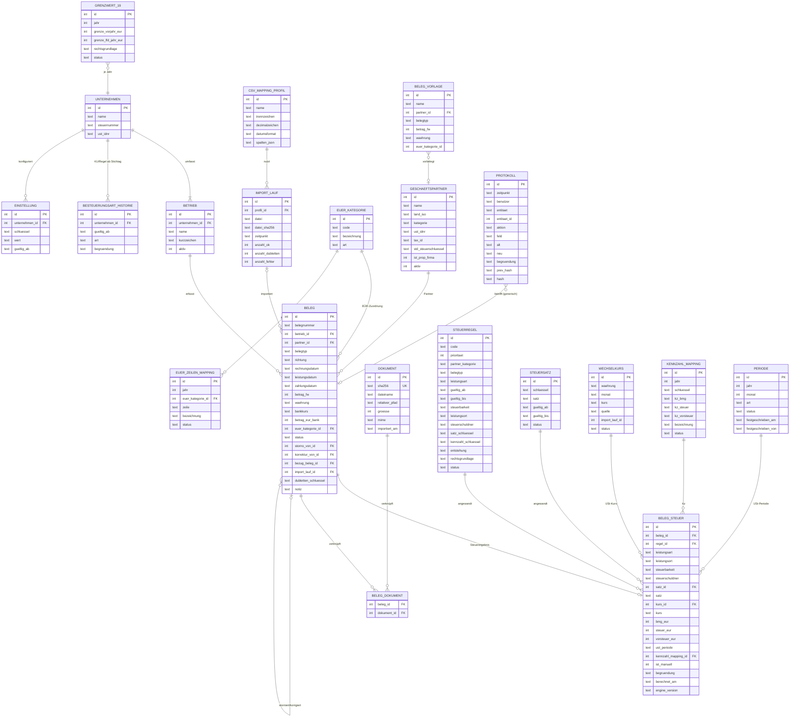

# Datenmodell (SQLite)

## Speicherkonventionen
| Art | SQLite-Typ | Beispiel | Begründung |
|---|---|---|---|
| Geldbetrag (EUR oder Fremdwährung) | `INTEGER` in Cent / kleinster Einheit | `9167` = 91,67 | exakt, in SQL summierbar |
| Kurs, Steuersatz | `TEXT`, Dezimalstring mit Punkt | `"1.0800"`, `"0.19"` | volle Präzision, keine Gleitkommazahl |
| Datum | `TEXT` ISO-8601 | `"2026-03-15"` | sortierbar |
| Zeitstempel | `TEXT` ISO-8601 UTC | `"2026-03-15T10:22:01Z"` | Protokoll |
| Enum | `TEXT` | `"DRITTLAND"` | lesbar, migrationsfest |
| Hash | `TEXT` hex | SHA-256 | Beleg- und Protokollintegrität |

Alle Tabellen haben `id INTEGER PRIMARY KEY`. Fachliche Stammdaten haben `aktiv` und `angelegt_am`.

## ER-Diagramm

## Tabellen – Erläuterungen

### Stammdaten
- **unternehmen**: genau ein Datensatz, das umsatzsteuerliche Unternehmen. Die §19-Prüfung läuft auf dieser Ebene.
- **betrieb**: z. B. „Prop-Trading“, „Onlinehandel“. Die EÜR wird je Betrieb geführt.
- **geschaeftspartner**: `kategorie` ∈ `INLAND | EU | DRITTLAND`, abgeleitet aus `land_iso`, aber übersteuerbar.
  `std_steuerschluessel` belegt die Regelwahl vor. Prop-Firmen kommen als Seed-Daten mit `ist_prop_firma = 1`.
- **belegvorlage**: für wiederkehrende Belege (z. B. > 250 gleichartige Challenge-Rechnungen).

### Belege
- **beleg.belegtyp**: `CHALLENGE_GEBUEHR | RESET | ACTIVATION | FUNDED_GEBUEHR | ABO_SOFTWARE | PAYOUT | ERSTATTUNG | SONSTIGE_AUSGABE | SONSTIGE_EINNAHME`
- **beleg.richtung**: `EINGANG` (Leistungsbezug) | `AUSGANG` (eigene Leistung/Einnahme)
- **Drei Daten:** `rechnungsdatum`, `leistungsdatum` und `zahlungsdatum`. Die EÜR nutzt das Zahlungsdatum (§11 EStG),
  die USt-Periode wird über `steuerregel.entstehung` bestimmt (siehe `docs/steuerregeln.md`, O-07).
- **status**: `ENTWURF | GEBUCHT | STORNIERT`. Ein gebuchter Beleg in einer festgeschriebenen Periode wird nie geändert.
- **storno_von_id / korrektur_von_id**: Ein Storno ist ein Gegenbeleg mit negativen Beträgen, eine Korrektur ein neuer Beleg.
- **bezug_beleg_id**: Eine Erstattung verweist auf die ursprüngliche Gebühr (§17 UStG).
- **dubletten_schluessel**: SHA-256 über normalisierte Felder (Partner, Datum, Betrag, Währung, Belegnummer).
  Er ist nicht `UNIQUE`, Dubletten werden beim Import gewarnt.
- **bankkurs / betrag_eur_bank**: optional für die EÜR mit tatsächlichem Kurs. Die Kursdifferenz ergibt sich aus der
  Gegenüberstellung mit `beleg_steuer.bmg_eur`.

### Steuer
- **beleg_steuer**: Snapshot des Engine-Ergebnisses. Er speichert `satz` und `kurs` als Wert **und** als Referenz,
  damit spätere Stammdatenänderungen festgeschriebene Werte nicht verändern. `engine_version` dient der Nachvollziehbarkeit.
  Bei `ist_manuell = 1` ist `begruendung` Pflicht (CHECK-Constraint).
- **steuerregel**: Eine Regel trifft zu, wenn alle nicht-NULL-Match-Felder passen und das Datum im Gültigkeitszeitraum liegt.
  Die höchste `prioritaet` gewinnt, bei Gleichstand liefert die Engine einen Fehler (keine stille Auswahl).
  - `steuerbarkeit`: `STEUERBAR | NICHT_STEUERBAR | KEIN_LEISTUNGSAUSTAUSCH`
  - `steuerschuldner`: `LEISTENDER | EMPFAENGER_13B_ABS1 | EMPFAENGER_13B_ABS2_NR1`
  - `entstehung`: `LEISTUNG_VA_ZEITRAUM | RECHNUNG_SPAETESTENS_FOLGEMONAT | ZAHLUNG | VEREINNAHMUNG`
- **kennzahl_mapping**: `schluessel` (z. B. `13B_ABS1_SONST_LEIST`) → Kz je Jahr. Startwerte sind als `UNGEPRUEFT` markiert.
- **wechselkurs**: `quelle` ∈ `BMF | BANK | MANUELL`. Pro (`waehrung`, `monat`, `quelle`) gibt es genau einen Kurs (UNIQUE).
  Die Notation lautet `1 EUR = kurs Fremdwährung`.
- **grenzwert_19**, **besteuerungsart_historie**: Die Grenzen werden je Jahr gepflegt, die Umschaltung erfolgt mit Stichtag.

### Perioden & GoBD
- **periode**: `art` ∈ `UST_MONAT | UST_QUARTAL | UST_JAHR | EUER_JAHR`, `status` ∈ `OFFEN | FESTGESCHRIEBEN`.
  Trigger verhindern `UPDATE`/`DELETE` an `beleg` und `beleg_steuer`, wenn die zugehörige Periode festgeschrieben ist.
- **protokoll**: nur `INSERT` (Trigger verbieten UPDATE/DELETE). Berechnung:
  `hash = SHA256(prev_hash || zeitpunkt || benutzer || entitaet || entitaet_id || aktion || feld || alt || neu || begruendung)`.
  Eine Integritätsprüfung über die gesamte Kette ist als Funktion vorgesehen (Phase 3).
- **dokument**: Ablage unter `belege/<sha256[0..2]>/<sha256>.<ext>`. Gleiche Dateien werden nur einmal gespeichert.

### Einstellungen (Schlüssel, Startwerte)
| Schlüssel | Startwert | Hinweis |
|---|---|---|
| `ust.voranmeldungszeitraum` | `MONAT` | konfigurierbar |
| `ust.dauerfristverlaengerung` | `false` | wird laut Nutzer nicht genutzt; Funktion bleibt abschaltbar vorhanden |
| `ust.payout_behandlung` | `NICHT_STEUERBAR` | `TODO-STEUER` O-04 |
| `euer.kurs_quelle` | `BMF` | alternativ `BANK` |
| `ui.benutzer` | `Inhaber` | Name im Protokoll |
